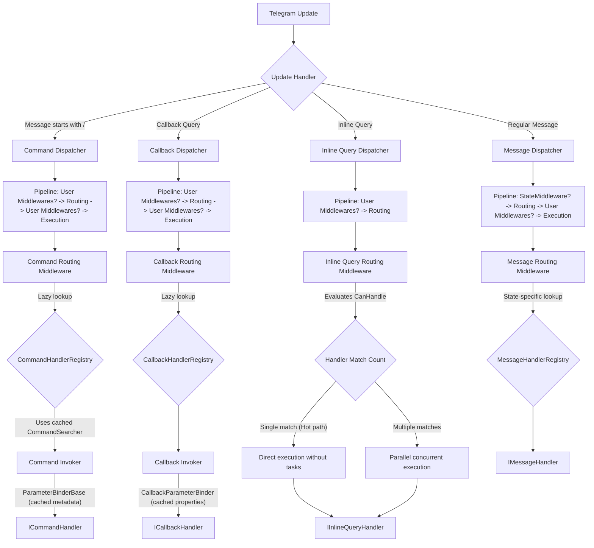

# Telegram.BotKit 🤖
<p align="left">
  <a href="https://www.nuget.org/packages/Telegram.BotKit"></a>
</p>

**A structured, extensible .NET 10 framework for building Telegram bots.**

Built on top of the popular [Telegram.Bot](https://github.com/TelegramBots/Telegram.Bot) library, adopting ASP.NET Core principles: Dependency Injection, strong typing, and highly customizable, modular middleware pipelines.

---

## 🏗 Architecture

The framework decouples input parsing, routing, and processing. Every incoming update flows through an isolated, scoped execution pipeline:


---

## ✨ Key Features

*   **🧠 Typo Correction:** Integrated Command Searcher powered by the **Damerau-Levenshtein** algorithm to suggest the closest registered commands to users.
*   **🛠 Strongly-Typed Parameter Binding:** Automatic mapping of URL-like query strings (`action?id=12`) and space-separated parameters into your custom DTOs.
*   **🚇 Modular Middleware Pipelines:** Separate, highly configurable pipelines for Commands, Callbacks, Inline Queries, and standard Messages. 
*   **🎯 Lazy Scoped Dependency Resolution:** Resolves **only the matched handler** per request instead of instating the entire handler collection, optimizing memory and DI scope lifetimes.
*   **🌐 Flexible Hosting Modes:** Automatically configures Long Polling or secure Webhook deployments. In Webhook mode, endpoints are dynamically mapped based on the configured Webhook URL using ASP.NET Core Minimal APIs.

---

## 🚀 Quick Start (Long Polling & Webhook)

### 1. Install NuGet Package
```bash
dotnet add package Telegram.BotKit
```

### 2. Configure Settings (`appsettings.json`)
The framework automatically chooses between Polling and Webhook modes based on the `Mode` setting.
```json
{
  "TelegramBot": {
    "Token": "YOUR_BOT_TOKEN_HERE",
    "AllowedUpdates": [ "Message", "CallbackQuery"... ],
    "Mode": "Polling" // Or "Webhook"
  }
}
```

### 3. Initialize the Application (`Program.cs`)
```csharp
using Microsoft.Extensions.DependencyInjection;
using Telegram.BotKit.Hosting;

var builder = BotApplication.CreateBuilder(args);

// Simple default setup - scans the calling assembly and sets up default pipelines
builder.Services
    .AddCommands()
    .AddCallbacks()
    .AddMessages()
    .AddInlineQueries();

builder.Services.AddSingleton<IUpdateHandler, YourUpdateHandler>();

var app = builder.Build();
await app.RunAsync();
```

---

## 🚇 Pipeline Customization

You can explicitly control the execution order of the pipelines. This is useful when you want to run global middlewares **before** the routing occurs (e.g., logging or rate-limiting) and other middlewares **after** the routing (e.g., role-based access validation).

```csharp
builder.Services.AddCommands(pipeline =>
{
    // 1. Run global logging for all incoming command attempts
    pipeline.UseMiddleware<CommandLoggingMiddleware>();

    // 2. Route the command (matches input to a concrete ICommandHandler)
    pipeline.UseRouting();

    // 3. Run middleware only for recognized commands (e.g., ensure user is an administrator)
    pipeline.UseMiddleware<AdminOnlyMiddleware>();
});
```

---

## 📖 Detailed Reference & Code Examples

For full implementation examples, including:
* Writing strongly-typed **Commands** & **Callbacks**
* Handling raw **Messages**
* Implementing **Stateful Dialogs (Finite State Machine / Wizard Flows)**
* Processing **Inline Queries** with dynamic routing
* Implementing a custom **Update Handler**

👉 **Check out the [📂 Telegram.BotKit.Example Documentation](Telegram.BotKit.Example/README.md)**