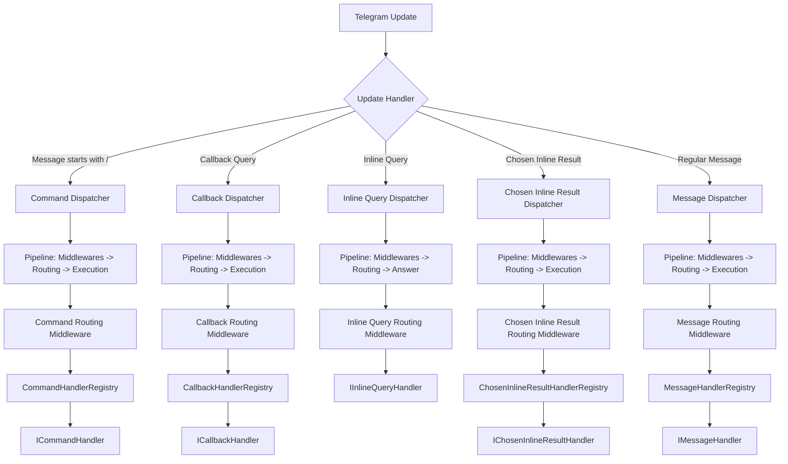

# Telegram.BotKit 🤖
<p align="left">
  <a href="https://www.nuget.org/packages/Telegram.BotKit"></a>
</p>

A structured .NET 10 framework for building Telegram bots on top of [Telegram.Bot](https://github.com/TelegramBots/Telegram.Bot), using dependency injection, strong typing, and middleware pipelines.

---

## 🏗 Architecture

Each incoming update is routed through an isolated execution pipeline:



---

## ✨ Features

* **Parameter Binding:** Maps command arguments and callback query strings (`action?id=12`) directly to typed models.
* **Typo Suggestions:** Suggests similar registered commands when an unknown command is received.
* **Modular Pipelines:** Configurable middleware pipelines for Commands, Callbacks, Messages, Inline Queries, and Chosen Inline Results.
* **State Routing:** Message routing based on dialog states (`RequiredState`) with fallback to global handlers.
* **Hosting Modes:** Polling and Webhook modes configured via options.

---

## 🚀 Quick Start

### 1. Install Package

```bash
dotnet add package Telegram.BotKit
```

### 2. Configure Settings (`appsettings.json`)

```json
{
  "TelegramBot": {
    "Token": "YOUR_BOT_TOKEN_HERE",
    "AllowedUpdates": [ "Message", "CallbackQuery", "InlineQuery", "ChosenInlineResult" ],
    "Mode": "Polling",
    "WebhookUrl": "https://your-domain.com/api/bot",
    "SecretToken": "your_secure_secret_token"
  }
}
```

### 3. Application Setup (`Program.cs`)

```csharp
using Telegram.Bot.Polling;
using Telegram.BotKit.Hosting;

var builder = BotApplication.CreateBuilder(args);

builder.Services
    .AddCommands()
    .AddCallbacks()
    .AddMessages()
    .AddInlineQueries()
    .AddChosenInlineResults();

builder.Services.AddSingleton<IUpdateHandler, BotUpdateHandler>();

var app = builder.Build();
await app.RunAsync();
```

---

## 🚇 Pipeline Configuration

Middleware order is explicit. Middlewares added before `UseRouting()` execute for every update; middlewares added after execute only when a matching handler is found:

```csharp
builder.Services.AddCommands(pipeline =>
{
    // runs for all command attempts
    pipeline.UseMiddleware<CommandLoggingMiddleware>();

    // matches the command against registered handlers
    pipeline.UseRouting();

    // runs only when a handler matched
    pipeline.UseMiddleware<AdminOnlyMiddleware>();
});

builder.Services.AddInlineQueries(pipeline =>
{
    pipeline.UseMiddleware<CustomInlineQueryErrorHandler>();
    pipeline.UseRouting();
    pipeline.UseAnswer<LoggingInlineQueryAnswerMiddleware>();
});
```

---

## 📖 Examples

See the implementation examples for commands, callbacks, state-based messages, inline queries, and error handling:

[Telegram.BotKit.Example Documentation](Telegram.BotKit.Example/README.md)