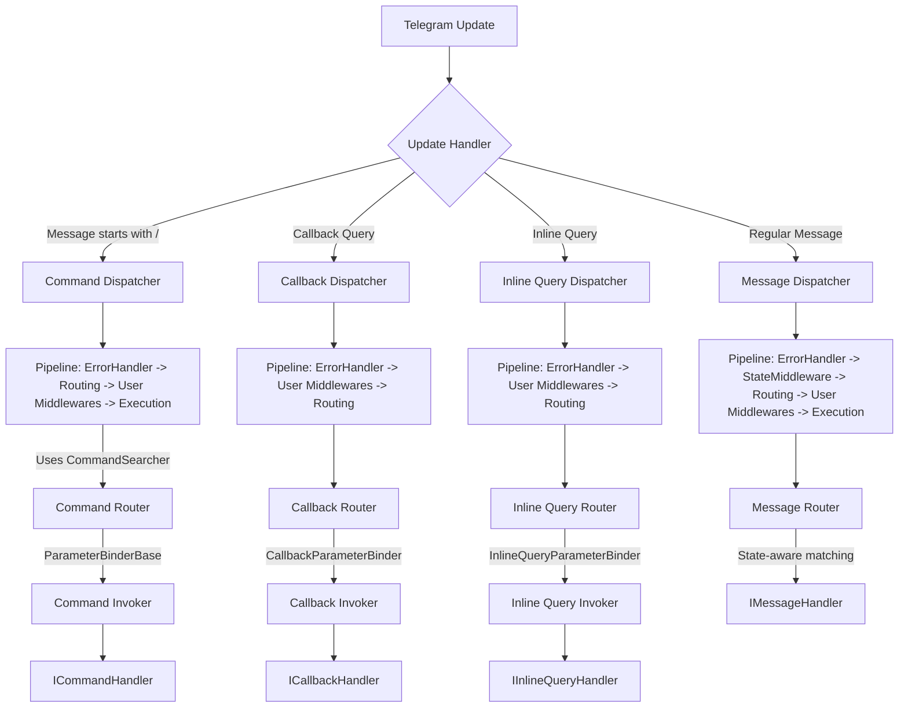

# Telegram.BotKit 🤖
<p align="left">
  <a href="https://www.nuget.org/packages/Telegram.BotKit"></a>
</p>

**A structured, extensible .NET 10 framework for building Telegram bots.**

Built on top of the popular [Telegram.Bot](https://github.com/TelegramBots/Telegram.Bot) library, adopting **ASP.NET Core** principles: strong typing, Dependency Injection, and a highly customizable Middleware Pipeline.

---

## 🏗 Architecture

The framework decouples input parsing, routing, and processing. Every incoming update flows through an isolated execution pipeline:



---

## ✨ Features

*   **⚡ Zero-Allocation Parameter Parsing:** Uses `ReadOnlySpan<char>` and Regex source generators to parse positional and named arguments (`key="value"`) with minimal GC pressure.
*   **🧠 Intelligent Typo Correction:** Integrated Command Searcher powered by **Damerau-Levenshtein distance** (with transposition, prefix, and sorted-character matching) to suggest correct commands if a user makes a typo.
*   **🛠 Strongly-Typed Parameter Binding:**
    *   **Commands:** Automatic binding to DTOs via `[CommandParam]` by position, name, or requirement constraint.
    *   **Callback Queries:** Automatic mapping of URL-like query strings (`action?id=12&confirm=true`) to properties using `[JsonPropertyName]`.
    *   **Inline Queries:** Fast parameter binding from input queries.
*   **🔄 Stateful Dialog Flows:** Route plain messages dynamically using `IMessageStateMiddleware` and state-bound handlers (`IMessageHandler.RequiredState`).
*   **🚇 Middleware Pipeline:** Separate pipelines for Commands, Callbacks, Inline Queries, and standard Messages. Register custom logging, rate-limiting, or authorization steps.

---

## 🔄 Stateful Dialogs (FSM)

A common bot pattern: a user triggers a flow (e.g., clicks a button or types `/setage`), the system expects a text answer next, and we route that specific text to a designated state-bound handler.

This is achieved using **UserState**, **State Middleware**, and **State-specific Handlers**:

```
[ User sends "/setage" ] ──> CommandHandler updates State to "awaiting_age" in Cache/DB
                                        │
[ User sends "25" ]      ──> StateMiddleware loads "awaiting_age" -> Assigns to context.UserState
                                        │
                             Router matches handler with RequiredState == "awaiting_age"
```

### 1. The State Storage abstraction (Example)

```csharp
public interface IStateStorage
{
    Task<string?> GetStateAsync(long userId);
    Task SetStateAsync(long userId, string? state);
}
```

### 2. State-Resolving Middleware (`IMessageStateMiddleware`)

Before routing standard messages, this middleware fetches the current conversational state of the sender and assigns it to `context.UserState`.

```csharp
using Telegram.BotKit;
using Telegram.BotKit.Abstractions;

namespace MyBot.Middlewares;

public sealed class UserStateMiddleware(IStateStorage stateStorage) : IMessageStateMiddleware
{
    public async Task InvokeAsync(MessageContext context, NextDelegate next, CancellationToken cancellationToken = default)
    {
        var userId = context.Message.From?.Id;
        if (userId is not null)
        {
            // Retrieve current state from cache/database and bind to context
            context.UserState = await stateStorage.GetStateAsync(userId.Value);
        }

        await next();
    }
}
```

### 3. Step 1: Initiating State via Command

```csharp
public sealed class SetAgeCommandHandler(IStateStorage stateStorage) : ICommandHandler<NoParams>
{
    public string Command => "setage";
    public string[] Aliases => [];

    public async Task HandleAsync(NoParams parameters, CommandContext context, CancellationToken cancellationToken)
    {
        // 1. Set the conversation state to "awaiting_age"
        await stateStorage.SetStateAsync(context.From.Id, "awaiting_age");

        // 2. Prompt user for input
        await context.Message.ReplyAsync("Please enter your age:", cancellationToken);
    }
}
```

### 4. Step 2: Processing and Resetting State via Message Handler

```csharp
using Telegram.BotKit;
using Telegram.BotKit.Abstractions;

namespace MyBot.Messages;

public sealed class AgeInputHandler(IStateStorage stateStorage) : IMessageHandler
{
    // Activated only if UserState matches "awaiting_age"
    public string? RequiredState => "awaiting_age";

    public bool CanHandle(MessageContext context) => 
        !string.IsNullOrWhiteSpace(context.Message.Text);

    public async Task HandleAsync(MessageContext context, CancellationToken cancellationToken)
    {
        var input = context.Message.Text!;
        var userId = context.Message.From!.Id;

        if (int.TryParse(input, out var age) && age is > 0 and < 120)
        {
            // Process valid input, save to DB...
            
            // Clear conversational state to exit the input loop
            await stateStorage.SetStateAsync(userId, null);
            await context.Message.ReplyAsync($"Age saved successfully: {age}!", cancellationToken);
        }
        else
        {
            // Validation failed: keep the state active and prompt again
            await context.Message.ReplyAsync("Invalid input. Please enter a valid number (1-120):", cancellationToken);
        }
    }
}
```

---

## 📦 Core Usage Examples

### 1. Strongly-Typed Commands (`ICommandHandler`)

Define your parameter DTO using `[CommandParam]` attributes.

```csharp
using Telegram.BotKit.Abstractions;
using Telegram.BotKit.Attributes;

namespace MyBot.Commands;

public sealed record DuelParams
{
    [CommandParam(Position = 0, Required = true)]
    public string OpponentName { get; init; } = default!;

    [CommandParam(Name = "rounds", Position = 1)]
    public int Rounds { get; init; } = 3;
}

public sealed class DuelCommandHandler : ICommandHandler<DuelParams>
{
    public string Command => "duel";
    public string[] Aliases => ["fight", "battle"];

    public async Task HandleAsync(DuelParams parameters, CommandContext context, CancellationToken cancellationToken)
    {
        // bound value example: /duel @alex rounds=5
        await context.Message.ReplyAsync(
            $"Initiating duel against {parameters.OpponentName} for {parameters.Rounds} rounds!",
            cancellationToken
        );
    }
}
```

### 2. Inline Keyboard Callbacks (`ICallbackHandler`)

Map query-like parameters (`game_move?x=2&y=1`) directly to properties.

```csharp
using System.Text.Json.Serialization;
using Telegram.BotKit;
using Telegram.BotKit.Abstractions;

namespace MyBot.Callbacks;

public sealed record MoveParams
{
    [JsonPropertyName("x")]
    public int X { get; init; }

    [JsonPropertyName("y")]
    public int Y { get; init; }
}

public sealed class MoveCallbackHandler : ICallbackHandler<MoveParams>
{
    public string Key => "game_move";

    public async Task HandleAsync(MoveParams parameters, CallbackContext context, CancellationToken cancellationToken)
    {
        var text = $"You played at coordinates: X = {parameters.X}, Y = {parameters.Y}";
        await context.Message.UpdateTextAsync(text, cancellationToken);
    }
}
```

### 3. Custom Middleware Integration

Inject custom logic globally into the command processing pipeline.

```csharp
using Telegram.BotKit;
using Telegram.BotKit.Abstractions;

namespace MyBot.Middlewares;

public sealed class CommandLoggingMiddleware(ILogger<CommandLoggingMiddleware> logger) : ICommandMiddleware
{
    public async Task InvokeAsync(CommandContext context, NextDelegate next, CancellationToken cancellationToken = default)
    {
        logger.LogInformation("Executing command /{Command} sent by {UserId}", context.Command, context.From.Id);
        await next();
    }
}
```

---

## 🛠 Advanced Features: Command Suggestions

If a user enters `/stert`, the integrated `CommandSearcher` analyzes the registered command index. Rather than failing silently, the routing engine throws a `CommandSuggestionsException` containing similar candidates using an optimized **Damerau-Levenshtein** algorithm:

```csharp
// Catches /stert and yields suggestions like: ["start", "set"]
try
{
    await _dispatcher.DispatchAsync(message);
}
catch (CommandSuggestionsException ex)
{
    var suggestionList = string.Join(", ", ex.Suggestions.Select(s => $"/{s}"));
    await client.SendMessageAsync(
        chatId: message.Chat.Id,
        text: $"Unknown command. Did you mean: {suggestionList}?"
    );
}
```

---

## 🚀 Getting Started

Check out the complete, runnable reference implementation in the [📂 Telegram.BotKit.Example](Telegram.BotKit.Example) directory, containing:
*   Pipeline configuration
*   Long polling vs Webhook setup
*   Complex multi-step Wizard flow implementations