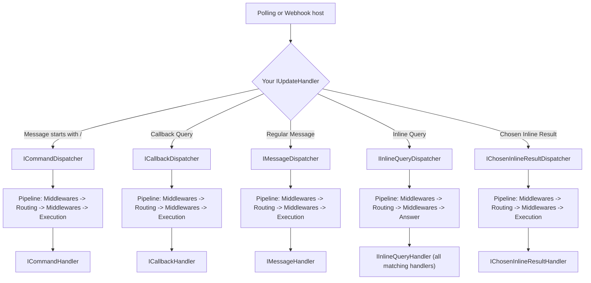

# Telegram.BotKit 🤖
<p align="left">
  <a href="https://www.nuget.org/packages/Telegram.BotKit"></a>
</p>

A structured .NET 10 framework for building Telegram bots on top of [Telegram.Bot](https://github.com/TelegramBots/Telegram.Bot), using dependency injection, strong typing, and middleware pipelines.

---

## 🏗 Architecture

Every update first reaches **your** `IUpdateHandler`, which hands it to the dispatcher of the matching kind. Each dispatcher runs its own isolated pipeline in a dedicated DI scope:



---

## ✨ Features

* **Parameter Binding:** Maps command arguments (`/remind buy milk when=18:00`) and callback data (`action?id=12`) to typed models.
* **Callback Data Builder:** `CallbackButton` builds the callback data of a handler from its typed model and checks Telegram's 64-byte limit.
* **Typo Suggestions:** An unknown command is routed with similar registered commands in `CommandContext.RouteResult`, so a middleware can answer "Did you mean ...?".
* **Modular Pipelines:** Middleware pipelines for Commands, Callbacks, Messages, Inline Queries, and Chosen Inline Results with an explicit routing position (`UseRouting()`).
* **State Routing:** Message routing by dialog state (`RequiredState`) with fallback to global handlers.
* **Inline Queries:** All matching handlers run (in parallel by default) and their results are merged into one answer.
* **Startup Validation:** `Build()` fails fast on a missing `IUpdateHandler`, invalid parameter models, or invalid options.
* **Hosting Modes:** Polling and Webhook, selected with a single setting.

---

## 🚀 Quick Start

### 1. Install Package

```bash
dotnet add package Telegram.BotKit
```

### 2. Configure Settings (`appsettings.json`)

```json
{
  "TelegramBot": {
    "Token": "YOUR_BOT_TOKEN_HERE",
    "AllowedUpdates": [ "Message", "CallbackQuery", "InlineQuery", "ChosenInlineResult" ],
    "Mode": "Polling"
  }
}
```

Webhook mode also needs `WebhookUrl` (an HTTPS URL whose path is the route the bot listens on) and, strongly recommended, `SecretToken`. All options are described in the [Example documentation](Telegram.BotKit.Example/README.md). Keep the token out of the repository (user secrets or the `TelegramBot__Token` environment variable).

### 3. Write the Update Handler

BotKit routes updates to handlers, but **you** decide which dispatcher gets which update:

```csharp
public sealed class BotUpdateHandler(
    ICommandDispatcher commands,
    ICallbackDispatcher callbacks,
    IMessageDispatcher messages,
    IInlineQueryDispatcher inlineQueries,
    IChosenInlineResultDispatcher chosenResults,
    ILogger<BotUpdateHandler> logger) : IUpdateHandler
{
    public Task HandleUpdateAsync(ITelegramBotClient bot, Update update, CancellationToken ct) => update switch
    {
        { CallbackQuery: { } query } => callbacks.DispatchAsync(query, ct),
        { Message: { Text: { } text } message } when text.StartsWith('/') => commands.DispatchAsync(message, ct),
        { Message: { } message } => messages.DispatchAsync(message, ct),
        { InlineQuery: { } query } => inlineQueries.DispatchAsync(query, ct),
        { ChosenInlineResult: { } result } => chosenResults.DispatchAsync(result, ct),
        _ => Task.CompletedTask
    };

    public Task HandleErrorAsync(ITelegramBotClient bot, Exception exception, HandleErrorSource source, CancellationToken ct)
    {
        logger.LogError(exception, "Update pipeline failed. Source: {Source}", source);
        return Task.CompletedTask;
    }
}
```

### 4. Application Setup (`Program.cs`)

```csharp
using Microsoft.Extensions.DependencyInjection;
using Telegram.Bot.Polling;
using Telegram.BotKit.Hosting;

var builder = BotApplication.CreateBuilder(args);

builder.Services
    .AddCommands()
    .AddCallbacks()
    .AddMessages()
    .AddInlineQueries()
    .AddChosenInlineResults();

builder.Services.AddSingleton<IUpdateHandler, BotUpdateHandler>();

var app = builder.Build();
await app.RunAsync();
```

Each `AddXxx()` scans the calling assembly for handlers (pass other assemblies explicitly). Register only the dispatchers your update handler uses.

---

## 🚇 Pipeline Configuration

The pipeline is: middleware before `UseRouting()` → routing → middleware after `UseRouting()` → handler. If `UseRouting()` is not called, routing runs first.

* Middleware before `UseRouting()` runs for every update and wraps everything after it (error handling, loading `MessageContext.UserState`).
* Middleware after `UseRouting()` runs **even when no handler matched**: check the routing result (`CommandContext.RouteResult`, `CallbackContext.MatchedCallbackMetadata`, ...).
* BotKit never replies on its own: unknown commands, binding errors, and handler exceptions are answered by your middleware.

```csharp
builder.Services.AddCommands(pipeline =>
{
    pipeline.UseMiddleware<CommandErrorMiddleware>();          // runs for all command attempts
    pipeline.UseRouting();                                     // matches the command against registered handlers
    pipeline.UseMiddleware<CommandRoutingResultMiddleware>();  // reacts to matched / not matched commands
});

builder.Services.AddInlineQueries(pipeline =>
{
    pipeline.UseRouting();
    pipeline.UseAnswer<LoggingInlineQueryAnswerMiddleware>();  // replaces the default answer step
});
```

---

## 📖 Examples

Handlers, middleware, state-based messages, inline queries, and the full configuration reference:

[Telegram.BotKit.Example Documentation](Telegram.BotKit.Example/README.md)
